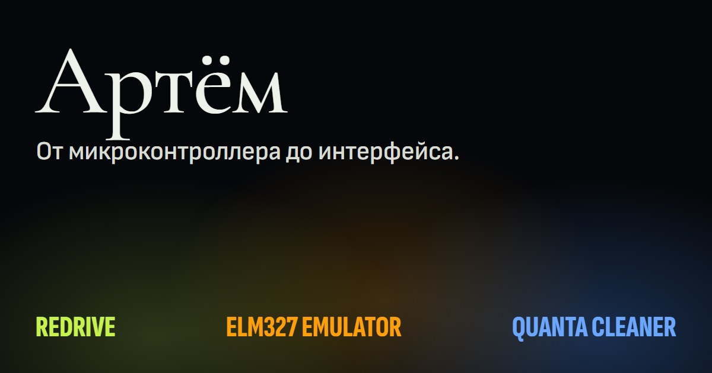

# Artyom · iUnreallx

Personal portfolio: Embedded, Automotive, C++/Qt and Flutter.

**[unreallx.ru](https://unreallx.ru)**



## Projects

| Project | What it is | Stack |
|---|---|---|
| [ReDrive](https://github.com/iUnreallx/ReDrive) | OBD-II dashboard app for ELM327 adapters | Flutter, Dart |
| [ELM327 Emulator](https://github.com/iUnreallx/ELM327-Emulator) | Tests OBD apps without a car | C++17, Qt 6, QML |
| [Quanta Cleaner](https://github.com/iUnreallx/Quanta-Cleaner) | Lightweight Windows junk cleaner | C++17, Qt 6 |

## About the site

A static site with no build step and no dependencies.

- A particle engine on Canvas 2D forms the name and project figures on the first screen
- Russian and English, dark and light themes
- Live star and download counts from the GitHub API
- A working model of the ELM327 question-and-answer protocol

## Structure

```
index.html        Markup and content in both languages
styles.css        Styles
main.js           Language, theme, galleries, GitHub data, emulator demo
hero.js           First screen and its sequence of figures
particles.js      Particle engine
counters.js       Number count-up on scroll
assets/           Screenshots, icons and precomputed point clouds
```

## Run locally

```bash
python -m http.server 8000
```

Hosted on GitHub Pages.
